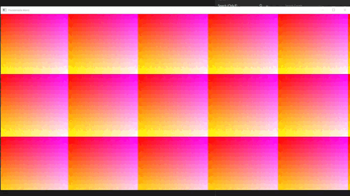

# Training Code: Handmade Hero

Desenvolvi esse código seguindo a série de Lives do canal *MollyRocket* em que **Casey Muratori** desenvolve um jogo em baixo nível, usando a linguagem de programação C, API do windows (Win32). O principal objetivo deste projeto é o estudo de programação de jogos em baixo nível, focando no alto desempenho e no entendimento da programação gráfica e de suas ferramentas.

## Links e Referências:

## AVISO:

Esse repositório não contém nenhum conteúdo ou asset pago, caso tenha interesse em adquirir os conteúdos, considere comprar no site oficial. Já mencionado acima.

## Dia: 005

Utilizamos a API do windows (Win32) para abrir uma janela, adicionar um título e responder as funções padrões de fechamento através das mensagens do sistema operacional. Também utilizamos um bitmap para realizar a renderização de pixels nessa janela, nós desenhamos nesse buffer armazenado na memória e depois copiamos todos os seus pixels para o bitmap da própria janela. Até o momento utilizamos um loop para desenhar um gradiente colorido que se move para o canto superior esquerdo.

## Ferramentas:

    IDE: Visual Studio Code (Escrever o código) / Visual Studio: Community (Debuggar)

    Linguagem: C/C++

    Build System: Batch File + MSVC (Compilador de C/C++ da Microsoft)

    API: Win32 | Libs: user32.lib + gdi32.lib

    OS: Windows 10

## Build e Debug:

Caso queira ver o código em funcionamento siga os passos abaixo:

    Clone o Repositório: git clone https://github.com/NickyDeviley/TC_HandmadeHero.git

Após ter o repositório clonado use o terminal para rodar o "Shell.bat" no diretório: 

    cd \handmade\misc

    shell

Depois agora entre na pasta **code** e execute o arquivo "build.bat" para gerar um executável:

    cd \handmade\code

    build

Para debuggar o projeto use:

    devenv \handmade\build\win32_handmade.exe

## Licença:

MIT License
